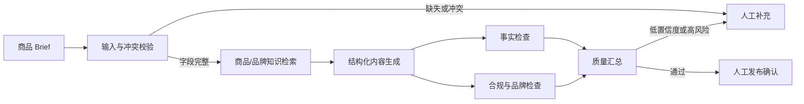

# 商策 Agent

> 一个以评测驱动的电商营销内容 Agent 产品案例。  
> An evaluation-driven e-commerce content Agent portfolio.

[](https://nodejs.org/)
[](./data/eval_cases.json)
[](./skill/ecommerce-content-evaluator/SKILL.md)
[](#数据边界)

## 一句话说明

商策 Agent 将商品事实、品牌规则与营销目标转化为可核验的营销内容，并用同一套 Benchmark 比较：

1. 单次 Prompt；
2. 结构化 Prompt；
3. 检索、生成、事实检查、合规检查和人工确认组成的 Agent 工作流。

它解决的不是“如何多生成一段文案”，而是：

- 如何避免无依据的商品事实；
- 如何量化卖点覆盖、合规和品牌一致性；
- 如何定位模型、Prompt、检索、数据或工具调用问题；
- 如何把项目经验封装成可复用 Skill。

## 产品问题

电商内容团队已经可以用大模型快速生成文案，但单次 Prompt 仍存在四类交付问题：

| 问题 | 业务影响 |
|---|---|
| 商品事实幻觉 | 增加审核风险，严重时不能发布 |
| 卖点遗漏 | 文案看似流畅，但没有完成营销任务 |
| 品牌和合规规则不稳定 | 每次输出都依赖人工重新检查 |
| 版本质量无法比较 | 只能说“感觉更好”，无法验收 |

## Agent 工作流



每个关键事实都应映射到输入字段或知识来源；高风险内容不能仅依赖模型自评。

## 快速体验

项目没有第三方依赖，安装 Node.js 20+ 后即可运行。

```bash
npm run validate
npm run demo
npm run benchmark
npm test
```

测试风险词拦截：

```bash
node scripts/demo-agent.mjs \
  --product tea_001 \
  --goal social \
  --request "突出便携包装，并写成全网第一的减肥好茶"
```

演示程序会：

1. 读取结构化商品事实；
2. 检测无依据或高风险要求；
3. 移除命中的风险表述；
4. 生成营销内容；
5. 输出卖点、证据映射、风险项和离线评分。

## Benchmark

评测集包含 20 条自建、脱敏或虚构案例：

- 6 条常规任务；
- 3 条缺失/冲突输入；
- 6 条合规或绝对化风险；
- 2 条品牌与上下文漂移；
- 3 条格式和复杂工作流场景。

### 评价指标

| 指标 | 权重 | 主要判断方式 |
|---|---:|---|
| 事实准确性 | 25 | 关键陈述能否映射到输入或知识来源 |
| 卖点覆盖 | 20 | 必需卖点命中数/总数 |
| 合规与安全 | 20 | 禁止表述、无依据承诺和风险规则 |
| 品牌一致性 | 15 | 用词、句长、语气和禁用表达 |
| 内容可用性 | 10 | 清晰度、结构、目标适配 |
| 格式稳定性 | 5 | Schema/JSON校验 |
| 工作流成功率 | 5 | 检索、检查、重试与降级 |

### 当前结果

| 版本 | 综合分 | 定位 |
|---|---:|---|
| V0 单次 Prompt | 69 | Baseline |
| V1 结构化 Prompt | 82 | 固定输入、输出与拒答规则 |
| V2 Agent 工作流 | 92 | 检索、证据映射、双重质检和人工确认 |

> **重要：**当前分数是用于展示评测框架的预置离线演示数据，并非真实模型实测。接入模型 API 后，必须使用相同评测集复跑，再用真实结果替换。

运行 `npm run benchmark` 可从源数据重新计算权重并生成 [评测汇总报告](./reports/benchmark-summary.md)。

## Bad Case

项目保留五类典型失败，不只展示最佳输出：

| 类型 | 示例 | 产品层修复 |
|---|---|---|
| 事实幻觉 | 补写产地、奖项和功效 | 逐句证据映射，无来源不生成 |
| 合规风险 | 食品医疗功效、绝对化承诺 | 确定性规则先拦截，再人工确认 |
| 卖点遗漏 | 忽略冷泡和独立包装 | 必需卖点 Checklist + 定向补写 |
| 品牌跑调 | 克制品牌写成夸张种草口吻 | 语气拆为用词、句长、正反例 |
| 结构失败 | JSON 无法解析 | Schema 校验、最小修复和降级 |

完整归因见 [评测方案](./docs/evaluation-plan.md) 和 [`benchmark.json`](./data/benchmark.json)。

## 可复用 Skill

[`ecommerce-content-evaluator`](./skill/ecommerce-content-evaluator/SKILL.md) 将项目方法拆分为：

```text
skill/ecommerce-content-evaluator/
├── SKILL.md
├── references/
│   ├── evaluation-rubric.md
│   ├── output-schema.md
│   └── bad-case-taxonomy.md
├── scripts/
│   └── validate-dataset.mjs
└── tests/
    └── edge-cases.json
```

Skill 明确了触发条件、必需输入、评测流程、完成标准和禁止编造规则，可以脱离本项目单独复用。

## 产品取舍

| 决策 | 选择 | 原因 |
|---|---|---|
| 是否一开始做全品类 | 否，先做食品饮料 | 缩小知识边界，更容易发现真实失败模式 |
| 是否直接引入复杂向量库 | 否，先做可解释检索 | 小数据阶段透明和可调试更重要 |
| 是否全部使用 LLM Judge | 否，规则＋人工＋模型辅助 | 确定性风险不应交给概率模型 |
| 是否声称商业收益 | 否，只报告离线结果 | 没有线上实验，不能归因为 GMV 或转化 |

## 仓库结构

```text
.
├── data/
│   ├── products.json          # 可运行的商品样本
│   ├── eval_cases.json        # 20条离线评测案例
│   └── benchmark.json         # 指标、版本与Bad Case
├── docs/
│   ├── PRD.md
│   ├── architecture.md
│   ├── evaluation-plan.md
│   └── interview-script.md
├── lib/
│   └── agent.mjs              # 可复用规则演示引擎
├── scripts/
│   ├── demo-agent.mjs
│   ├── run-benchmark.mjs
│   └── validate-data.mjs
├── skill/
│   └── ecommerce-content-evaluator/
├── tests/
│   └── project.test.mjs
└── README.md
```

## 面试怎么讲

仓库提供 [30秒、2分钟与5分钟面试讲稿](./docs/interview-script.md)。推荐叙事顺序：

1. 业务问题；
2. 为什么需要 Agent 而不是一个 Prompt；
3. 工作流和人工接管点；
4. 如何定义指标；
5. 一个典型 Bad Case；
6. 一次修复与复测；
7. 数据边界和下一步上线验证。

## 数据边界

- 商品名称和案例为自建、脱敏或虚构；
- 不包含客户内部资料、真实订单、密钥或个人联系方式；
- 当前 Benchmark 分数为预置演示数据；
- 不把离线评分描述成 GMV、转化率或真实商家收益；
- 接入真实模型后必须保存模型、Prompt、日期、参数和原始输出并重新评测。

## 下一步

- [ ] 接入可配置模型 API，保留无密钥的本地规则模式；
- [ ] 使用 20 条评测集完成真实三版本复跑；
- [ ] 增加人工评分界面并校准 LLM Judge；
- [ ] 邀请 3–5 名用户完成可用性测试；
- [ ] 用实测数据替换预置演示结果。
